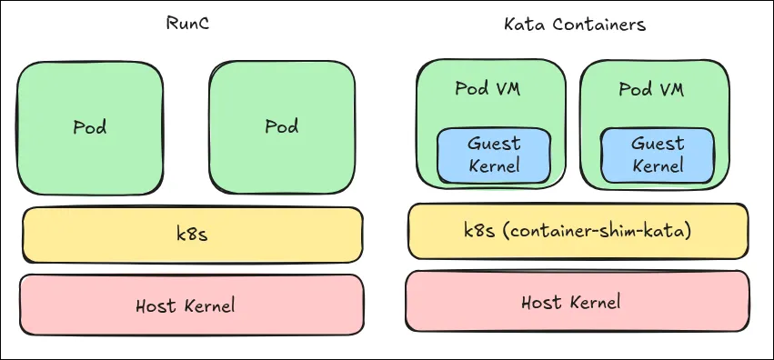
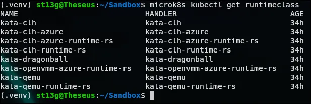
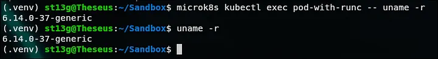
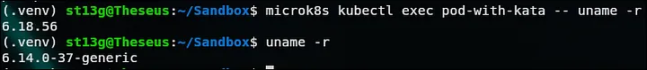
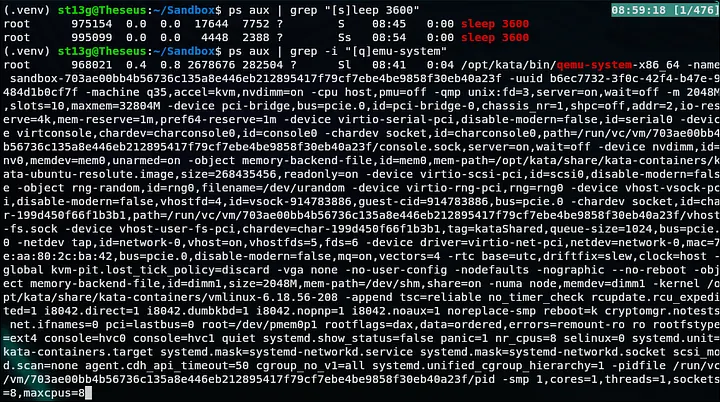
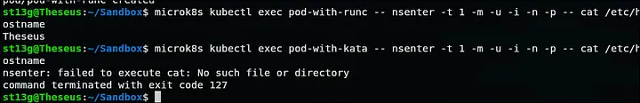
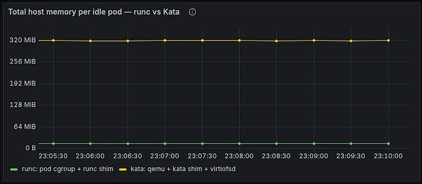
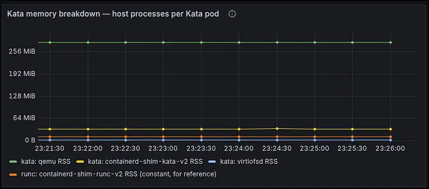
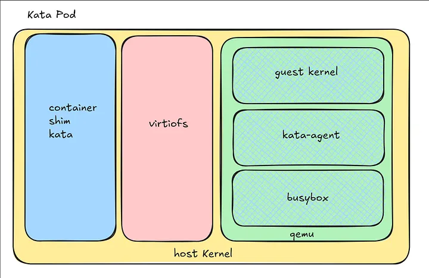
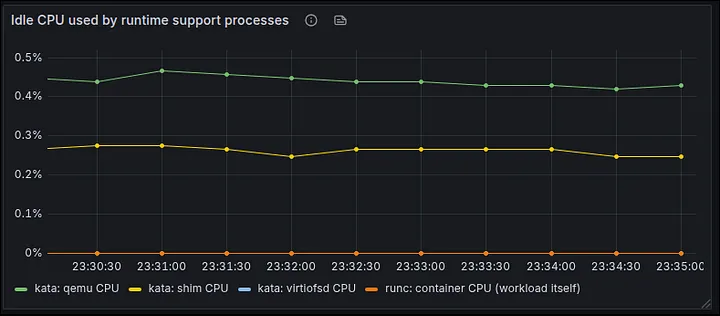

I’m quite sure you have been there, when a provider tells you that you need to run their binary, and just gives you the image or some Helm chart that you must run in order to use it.

But underneath lies an image that you don’t know, that you dont trust, that you can’t audit. Or take another case, you are deploying a model, and the image doesn’t come with the model itself, its downloaded at startup time, so you don’t know what the model can bring.

All of these scenarios are critical if you are a bank or a fintech and you process data with this image, and you use this model to predict something else.

To solve this problem ,an OpenInfra project arises: “Kata Containers”, This is the first part of a serie talking about Confidential Containers.

So you may be are wondering, what is really is Kata Containers?, Its an OCI runtime that runs each pod inside a lightweight virtual machine, but how is that different from the classic runc that Kubernetes uses by default.

Usually, when you run under the runc RuntimeClass, all the pods share the same kernel as the worker node, so they share the syscalls. If a vulnerability is eventually found, it can affect all the pods. In the case of Kata, if a bug is exploited, it only exposes one pod; the attackers would need to break the hypervisor’s kernel to access the other pods, so all workloads using Kata are sandboxed.

Let’s try this out and see if it really solves this problem. Personally, I use MicroK8s because I’m currently using Ubuntu, but you can use any other Kubernetes flavor you have. With Ubuntu, I can easily install MicroK8s with classic confinement and enable observability with just a few commands.

First things first, let’s install Kata in order to be able to be use as a RuntimeClass inside microk8s.

You can find the installation process below.

[Kata Helm installation guide](https://kata-containers.github.io/kata-containers/helm-configuration/?source=post_page-----d6a62630a54b-----------------------------------------)

Once you have it installed, you can list all the runtimes that are present in your cluster.

Now let’s use kata-qemu as a runtimeclass.

### Isolation
Now, we are going to create two pods with runc as the default and one with Kata. Then we are going to run uname -r .

As we can see in the images below, runc as expected shares the host kernel, while the Kata pod, it use a totally different kernel.

The only difference between those pods is that a RuntimeClass was added to the second one.

This is the proof that the container are not just isolated by namespaces, They are now running inside their own lightweight VM.

### Process Visibility
In both pods, I’ve spawned a specific process, sleep 3600.

In the runc pod, as expected from the host machine, we can see the process “sleep 3600” from the host machine, because it’s running with runc, that it’s just a regular process wrapped in namespaces.

On the other side, in the Kata pod, there is no sleep process at all, only the QEMU process is visible , the process lives inside the provisioned machine, out of reach from the host machine.

### Breaking from a privileged pod to the host machine.
For a moment, let’s analyze the command below, and what I’m really trying to achieve with it.

nsenter, as its name suggests is a command to enter namespaces, it attaches to the namespace of a process in this case PID 1, and within that process I’m accessing to the mount namespace in order to execute “cat /etc/hostname”

Here we have the two outcomes, in the runc pod, with the shared host kernel there is no boundary, so the container can access to the host’s hostname.

On the contrary, in the Kata pod, the command tries to access the PID 1, that in a normal machine is the init process, so it fails.

---

When I was a little more younger, I used to visit my local parish, there was a lot of books, and one in particular caught my attention, “Luces y sombras de la Iglesia” and I can’t recall it well, but one part of the book said “Donde hay mucha luz, la sombra es más intensa. — Where there is much light, the shadow is more intense”.

You may be wondering, why I’ve suddenly changed the subject , from containers to religion. Well, not everything that shines is exactly gold. In this case Kata seems too good to be true, there must be a catch somewhere, and you are right, there is a catch. Some disadvantages you may want to take into consideration if you really want to use it in your organization.

With both containers already scheduled, all I needed was to enable observability on microk8s, you can easily do that with, “microk8s enable observability” which under the hood installs the tempo, grafana and prometheus daemonsets to scrape metrics from the cluster and pods.

These dashboards show a clear difference in usage memory usage, when the pods are idle, as we can see, by default Kata uses around ~ 320MiB, because, Kata is a whole virtual machine.

With runc, the container is just a normal Linux process. With Kata, there is a lot more processes in ordert to run a busybox image, container-shim-kata-v2, it would be the hypervisor and virtiofs, which is the glue between host’s filesystem and the VM.

What is virtiofs?

If you remember, the image is inside a lightweight virtual machine, and this machine can’t see the host’s files. Something must carry the files across that boundary, and virtiofs solves that problem.

The host kernel is the actual system (microk8s), then we have container-shim-kata-v2 that is the pod manager, k8s never talks to the VM directly, this talks to QEMU to create the vm, virtiofs shares the container’s files from the host into the VM. and finally we have qemu, the program that is the virtual machine, inside it, there is the guest kernel, kata-agent which receives the shim commands to create the actual container and busybox the actual workload.

Now, this panel show how much CPU each process takes to keep pods idle. In short QEMU, is never idle because it in charge to keep running a whole operating system inside it.

So far, we can actually see three things.

The pod that run under Kata RuntimeClass is sandboxed, any workload within the container can reach outside. If the workload is compromised it can only reach the pod’s guest kernel.

The cost to run Kata is mostly RAM.

Kata is more complex to debug and monitor, because is a sandboxed environment.

So when should you use Kata?
When the workload is untrusted or it has third party code, when compliance or security requires some level of isolation, or when it’s a sensitive workload.

Next in the series is “Confidential Containers”. I also want to write about a CNCF project kubevirt that may replace some hypervisors in the future and how it’s diferent from Kata.

